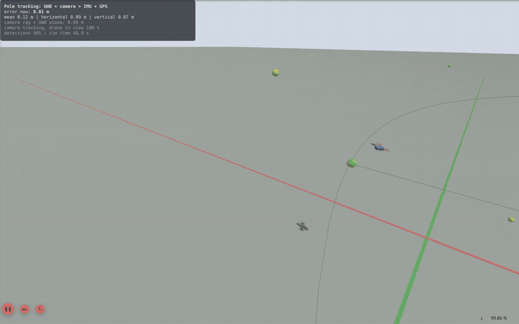
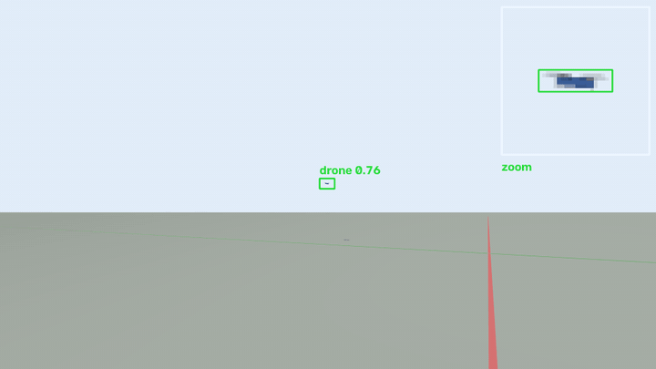

# drone_localization

locates a quadrotor in 3d. the current setup is a pole beside its flight
path carrying a uwb anchor (range to a tag on the drone) and a camera on a
pan-tilt mount whose images go through a yolo detector (bearing to the
drone). a kalman filter fuses range and bearing, optionally with the drone's
own imu and gps, into a 3d position. everything runs in gazebo harmonic and
is scored against the true pose.

the xbus/imu parser, matrix/kalman core, simulation helpers and gazebo gui
overlay come from [gnss-imu-fusion](external/gnss-imu-fusion), included as a
git submodule. its sibling project, `gnss_imu_prediction`, estimates and
predicts the drone's position from its own gps and imu.

guides: [getting started](docs/getting-started.html) ·
[how it works](docs/how-it-works.html)

## layout

| path | what |
|---|---|
| `sim/src/pole_estimator.hpp` | the filter (header only, target `pole_estimator`) and the pole camera model |
| `sim/src/pole_tracking_sim.cpp` | gazebo bridge: simulated uwb, detections → rays, pan-tilt steering, scoring |
| `sim/worlds/pole_tracking.sdf` | the world: drone, pole, pan-tilt camera |
| `sim/detector/` | yolo setup, dataset generation, training and the live detector |
| `sim/run_pole.sh` | builds and runs gazebo, detector and bridge |
| `test/cpp/` | unit tests of the estimator |
| `external/gnss-imu-fusion/` | submodule: shared libraries, gui overlay, `sim/gui.config` |

## building

needs cmake ≥ 3.22 and a c++20 compiler; the simulation needs gazebo
harmonic (on fedora: the `gazebo` distrobox, ubuntu 24.04 with `gz-harmonic`
from packages.osrfoundation.org).

```
git clone --recurse-submodules <url>/drone_localization
cd drone_localization        # or, in an existing clone: git submodule update --init
cmake -S . -B build
cmake --build build
ctest --test-dir build
```

for local clones side by side, git refuses `file://` submodules by default:
`git -c protocol.file.allow=always submodule update --init`.

## simulation

the same quadrotor is tracked from a pole beside its flight path. the pole
carries a uwb anchor (range, 20 hz) and a camera on a pan-tilt mount. a yolo
detector finds the drone in the camera image and each detection becomes a
bearing ray. `pole_tracking_sim` fuses the ranges and rays, optionally with
the drone's own imu and gps, and scores the estimate against the true pose.
the camera is turned towards the estimate (never the ground truth), slew
rate limited, so it keeps the drone in view. detections arrive late because
yolo takes time, so all measurements are buffered and fused in timestamp
order a fixed time behind the simulation.



what the pole camera sees, with yolo's detection and a zoomed inset:



the detector is trained once on images generated from simulated flights,
labelled from the true pose:

```
distrobox enter gazebo -- sim/detector/setup.sh     # yolo into build-sim/yolo-venv
distrobox enter gazebo -- sim/detector/train.sh     # dataset + training, writes build-sim/drone.pt
```

then:

```
distrobox enter gazebo -- sim/run_pole.sh                                # with the gazebo window
distrobox enter gazebo -- sim/run_pole.sh --headless --duration 120      # terminal only
distrobox enter gazebo -- sim/run_pole.sh --no-gps --no-imu              # camera and uwb only
```

`run_pole.sh` builds into `build-sim/`, starts gazebo with an extra panel
showing what yolo sees, runs the detector (`sim/detector/detect.py`) and the
bridge, which prints the fused error every second. gazebo and detector logs
go to `build-sim/gz.log` and `build-sim/detector.log`. the camera needs a
display even with `--headless`. `DETECTOR_IMGSZ` sets the yolo input size
(default 1280). options:

| option | default | |
|---|---|---|
| `--no-gps` | | don't use the gps |
| `--no-imu` | | don't use the imu |
| `--uwb-noise m` | 0.1 | uwb range noise |
| `--gps-noise m` | 1.5 | white gps position noise |
| `--latency s` | 0.4 | fuse measurements this far behind the simulation |
| `--duration s` | forever | stop after this much simulated time |
| `--radius m` | 8 | figure-eight loop radius |
| `--altitude m` | 8 | cruise height above the ground |
| `--altitude-swing m` | 3 | how far it climbs and descends around the cruise height |
| `--seed n` | 1 | noise seed |
| `--csv file` | | write the estimate and ground truth to a file |
| `--no-follow` | | don't move the gui camera with the drone |
| `--fixed-camera` | | keep the pole camera in its rest pose instead of turning it towards the drone |
| `--slew-rate deg` | 120 | pan-tilt speed limit, degrees per second |
